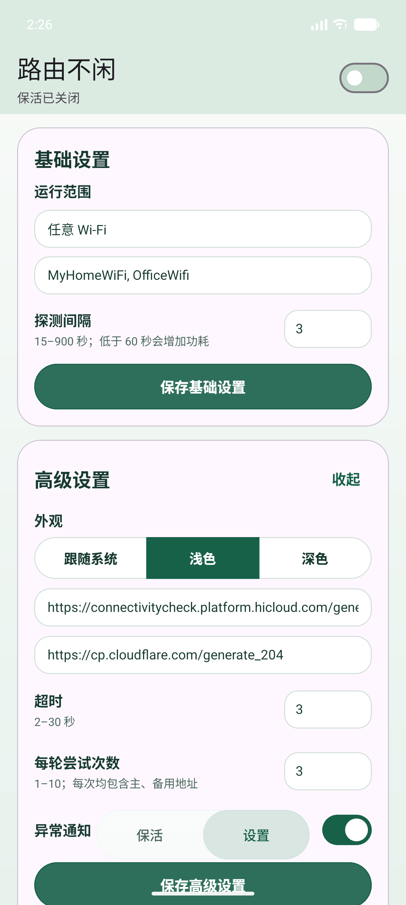
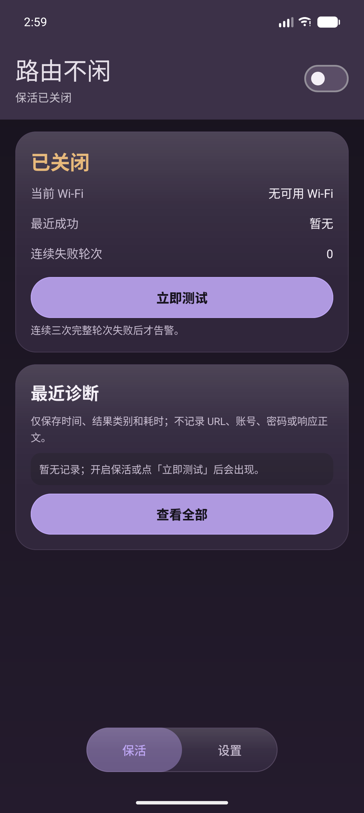

# 路由不闲（Android）

> 一个把 Wi-Fi 连接"用活"的小工具：用户主动开启后，以低频 HTTPS 请求制造外网活动，避免路由器因长时间无流量而断开或休眠；连续三轮完整探测失败时发出告警。

这是 HarmonyOS NEXT 版「路由不闲」的 Android 移植版，**一比一复刻**鸿蒙版的功能、界面、交互逻辑与隐私约束。源码在 `android/` 目录，使用 Kotlin + AndroidView（无 Compose 依赖，便于逐行对照 ArkTS 原始实现）。

- applicationId / bundleName：`com.fft.routerkeepalive`（与鸿蒙版一致）
- versionCode / versionName：`1000015` / `1.0.9`（与 `AppScope/app.json5` 一致）
- minSdk 24（Android 7.0）/ targetSdk 36
- 设备类型：phone、tablet（横竖屏、折叠屏自适应）
- 默认间隔 60 秒，可配置 15–900 秒
- 默认主地址：`https://connectivitycheck.platform.hicloud.com/generate_204`
- 默认备用地址：`https://cp.cloudflare.com/generate_204`

## 截图

| 浅色 | 深色 |
| --- | --- |
|  |  |

| 设置页 | 诊断记录 |
| --- | --- |
|  |  |

## 构建与安装

需要 **JDK 17** 与 **Android SDK（platform 36、build-tools 36.1.0）**。

```bash
# 1. 指向你的 SDK（也可直接用 Android Studio 打开工程，会自动生成）
echo "sdk.dir=/path/to/Android/Sdk" > local.properties

# 2. 单元测试（与鸿蒙 hypium 套件逐条等价）
./gradlew testDebugUnitTest

# 3. 静态检查
./gradlew lintDebug

# 4. 可安装 APK（debug 已用平台 debug 密钥签名）
./gradlew assembleDebug

# 5. 未签名 release（上架前请自行配置签名）
./gradlew assembleRelease
```

Windows 下把 `./gradlew` 换成 `gradlew.bat`。

产物：

- `app/build/outputs/apk/debug/app-debug.apk`（可直接 `adb install`）
- `app/build/outputs/apk/release/app-release-unsigned.apk`（需自行签名）

安装：

```bash
adb install -r app/build/outputs/apk/debug/app-debug.apk
adb shell am start -n com.fft.routerkeepalive/.MainActivity
```

> `local.properties` 不在版本控制中（含机器相关路径）。换机构建时删除它，由 Android Studio 或 `gradlew` 重新生成。

## 权限说明

| 权限 | 用途 |
| --- | --- |
| `INTERNET` / `ACCESS_NETWORK_STATE` | 发起探测、判断网络状态 |
| `ACCESS_WIFI_STATE` | 读取 Wi-Fi 可用性 |
| `NEARBY_WIFI_DEVICES`（Android 13+） | 读取 SSID，"仅目标 Wi-Fi" 范围需要；已声明 `neverForLocation` |
| `FOREGROUND_SERVICE` + `FOREGROUND_SERVICE_DATA_SYNC` | 前台服务保证后台持续保活 |
| `POST_NOTIFICATIONS`（Android 13+） | 常驻通知与失败告警 |

## 许可证

MIT，见 [LICENSE](LICENSE)。

## 源码对照表（鸿蒙 → Android）

| 鸿蒙源文件 | Android 源文件 | 说明 |
| --- | --- | --- |
| `entry/src/main/ets/domain/AppSettings.ets` | `domain/AppSettings.kt` | `RunScope`、`AppSettings`、默认值、SSID 归一化与校验逐行等价 |
| `entry/src/main/ets/domain/DiagnosticLog.kt` | `domain/DiagnosticLog.kt` | 100 条环形缓冲、`\u001f` 分隔序列化、脱敏类别、`HH:mm:ss · CATEGORY · 123 ms` |
| `entry/src/main/ets/domain/ProbeState.ets` | `domain/ProbeState.kt` | 探测类别、主备合并、三轮失败告警阈值 |
| `entry/src/main/ets/domain/RuntimePresentation.ets` | `domain/RuntimePresentation.kt` | 等待原因文案、后台取消原因、`dataTransfer` 进度算法 |
| `entry/src/main/ets/domain/BackgroundTaskState.ets` | `domain/RuntimePresentation.kt`（同文件） | 后台任务可用性推导 |
| `entry/src/main/ets/domain/WifiConnectivity.ets` | `domain/RuntimePresentation.kt`（同文件） | 读到 SSID 即视为 Wi-Fi 可用 |
| `entry/src/main/ets/domain/SystemBarTheme.ets` | `domain/RuntimePresentation.kt`（同文件） | 系统栏内容色 |
| `entry/src/main/ets/data/SettingsStore.ets` | `data/SettingsStore.kt` | 同名 SharedPreferences 文件 `router_keepalive`、同键名、同 `\u001f` 列表分隔 |
| `entry/src/main/ets/network/ProbeClient.ets` | `network/ProbeClient.kt` | 同超时、同类别映射；**额外**固定到 Wi-Fi Network 并禁用自动重定向 |
| `entry/src/main/ets/network/WifiMonitor.ets` | `network/WifiMonitor.kt` | 可用性只看 bearer 为 Wi-Fi，SSID 尽力读取 + 超时兜底 + 重新枚举 |
| `entry/src/main/ets/service/NotificationService.ets` | `service/NotificationService.kt` | 同通知 id、同文案、同进度值 |
| `entry/src/main/ets/service/KeepAliveController.ets` | `service/KeepAliveController.kt` | 同状态机、同门控、同失败跟踪、同诊断落盘 |
| `entry/src/main/ets/ui/RouterTheme.ets` | `ui/RouterTheme.kt` | 浅色/深色调色板逐值一致 |
| `entry/src/main/ets/ui/RouterUiPolicy.ets` | `ui/RouterUiPolicy.kt` | 窗口分级、列布局阈值、内边距合并、安全区换算 |
| `entry/src/main/ets/ui/LiquidHeaderPolicy.ets` | `ui/LiquidHeaderPolicy.kt` | 40vp 折叠区间、高度/标题字号插值；`bottomRadius()` 恒为 0 |
| `entry/src/main/ets/ui/DockMotionPolicy.ets` | `ui/DockMotionPolicy.kt` | 320ms fast-out-slow-in、帧率封顶 144Hz、idle 释放 |
| `entry/src/main/ets/components/MetricRow.ets` | `layout/fragment_keep_alive.xml` | 14sp 双列文字行，无分割线 |
| `entry/src/main/ets/components/NumberFieldRow.ets` | `layout/view_number_field.xml` | 同标签/提示/92dp 数字输入框 |
| `entry/src/main/ets/pages/Index.ets` | `MainActivity.kt` + `ui/*Fragment.kt` | 单页双 Tab、粘性玻璃头、卡片集、浮动 Dock、诊断详情页 |
| `entry/src/main/ets/entryability/EntryAbility.ets` | `service/KeepAliveService.kt` + `MainActivity.kt` | 沉浸式边到边、安全区监听、配置变化跟随 |

## 界面复刻说明

- **页面背景**：`pageTop → pageBottom` 180° 线性渐变，与 ArkUI `linearGradient({ angle: 180 })` 同色同方向。
- **粘性玻璃头**：两个 Tab 各自的 `LiquidHeader` 高度、标题字号随滚动进度在 40vp 区间插值；顶部安全区 + `contentInset(safeLeft, 18/24)`，与 ArkUI 计算完全一致。2026-10-09 最终版把 `bottomRadius()` 改成恒为 0，所以头部是方角 + 1dp 底边框。
- **卡片**：StatusCard / DiagnosticsCard / GuidanceCard / BasicCard / AdvancedCard，同顺序、同字号（23/20/15/13/12）、同内边距 18dp、同 24dp 圆角、同 1dp 边框色（`glassBorder`）。卡片背景直接用 ArkUI 的 `glass()` 半透明值，**不加 elevation 阴影**——鸿蒙靠 `backgroundEffect` 毛玻璃浮起，加阴影会变成另一种设计语言。
- **MetricRow**：纯文字行（label 14sp `secondaryText` / value 14sp `primaryText`），行间 5dp，**没有分割线**。
- **按钮**：统一 `actionSurface()` 填充 + 1dp `accent()` 边框 + `onAccent` 文字（浅色白字 / 深色深字），48dp 高、24dp 圆角、**无阴影**。不跟随 Material `colorPrimary`，否则浅色主题下会变成紫色。
- **输入框**：ArkUI 风格——16dp 圆角、`controlSurface()` 底、`controlBorder()` 细边框、**placeholder 常驻**（不用 Material 浮动标签），聚焦时边框转 `controlFocus()`。
- **NumberFieldRow**：左侧 15sp 标签 + 12sp 提示，右侧 92dp 数字输入框，与 `components/NumberFieldRow.ets` 结构一致。
- **诊断内嵌面板**：`glassInset()` 底 + 12dp 圆角 + 10dp 内边距（详情页 16dp/14dp），记录行 4dp 间距、统一 `primaryText` 色。
- **双列布局**：`homeUsesColumns` / `settingsUsesColumns` 阈值（<600、<840、<1280）与鸿蒙一致；宽屏首页 7:5，设置页 5:7。
- **底部 Dock**：浮动 112×52 两个 Tab（保活 / 设置），同 32dp 圆角、同 `glass()` 底 + `glassBorder()` 描边、同 `safeBottom + dockExtraMargin` 外边距；选中标签用 `accent()` 加粗。
- **外观切换**：跟随系统 / 浅色 / 深色，与 ArkUI 一样通过 `AppCompatDelegate` 应用到整个进程，并同步切换系统栏图标明暗。
- **诊断详情**：从「查看全部」进入，展示 100 条、支持复制与清空；「返回」回到主页。
- **无障碍/动效**：`reduceMotion` 对应系统「移除动画」设置，开启时折叠进度二值化，与 ArkUI `accessibility.isAnimationReduceEnabledSync()` 行为一致。

### 设计语言差异的处理原则

ArkUI 的「毛玻璃」由 `backgroundEffect({ radius, saturation, brightness })` 提供——Android 对普通 View 没有等价的背后模糊能力（`RenderEffect` 只作用于自身绘制）。因此：

- **保留**：ArkUI 的**精确色值**（`glass()` / `glassInset()` / `glassBorder()` 等都带 alpha）、圆角、边框、间距、字号。
- **不加**：Material 的 elevation 阴影、分割线、浮动标签——这三样会把「轻」的鸿蒙设计变成「重」的 Material 设计。
- **得到**：视觉上与鸿蒙一致，同时 Material 组件仍提供 ripple、状态管理和无障碍支持。

## 平台差异（必须阅读）

1. **后台保活机制不同，语义对齐**。鸿蒙用 `backgroundTaskManager.startBackgroundRunning(['dataTransfer'])` 持续任务；Android 没有等价的「dataTransfer 长时任务」，改用**前台服务**（`foregroundServiceType="dataSync"`）+ 低优先级常驻通知。这是 Android 上唯一能稳定在退到后台/锁屏后继续周期联网的方案。`KeepAliveController.backgroundRunning` 在鸿蒙上表示「持续任务已确认 ACTIVE」，在 Android 上表示「前台服务正在运行」，两者对状态机的影响一致。
2. **探测可以真正固定走 Wi-Fi**。鸿蒙 `http` API 无法把请求绑定到指定 `NetHandle`，README 中记录的「出口竞态」与「可能被门户重定向算作成功」两个限制在 Android 上都不存在：`ProbeClient` 通过 `Network.openConnection()` 绑定当前 Wi-Fi，并显式 `instanceFollowRedirects = false`，门户 302 会按 `REDIRECT` 类别计为失败。
3. **通知形态不同**。鸿蒙的 `LIVE_VIEW` / `downloadTemplate` 系统实时视图没有 Android 对应物，改为前台服务通知 + 进度条；告警通知改用高优先级渠道。通知 id（2001 / 2002）、标题与正文文案保持一致。
4. **开机自启仍未实现**。鸿蒙版明确说明「普通三方应用没有可靠合规的开机拉起能力，界面明确显示不支持」；Android 版保持一致，**不注册** `BOOT_COMPLETED` 接收器，避免做出无法兑现的承诺。
5. **权限集**。鸿蒙声明 `INTERNET` / `GET_NETWORK_INFO` / `GET_WIFI_INFO` / `KEEP_BACKGROUND_RUNNING`；Android 对应声明 `INTERNET` / `ACCESS_NETWORK_STATE` / `ACCESS_WIFI_STATE` / `FOREGROUND_SERVICE` / `FOREGROUND_SERVICE_DATA_SYNC`，另加 `POST_NOTIFICATIONS`（Android 13+ 需要用户授权才能发通知，与鸿蒙「需允许通知」的验收步骤对应）。
6. **`versionCode` 覆盖安装注意**。与鸿蒙侧坑位对应：修改代码后若安装出现「生效一半」，先递增 `versionCode` 再 `adb install -r`。

## 隐私与数据

- 本地最多保留 100 条诊断，界面展示最近 3 条（主页）或 100 条（详情页），字段只有 `timestamp`、`category`、`durationMs`。
- 不写入 URL、SSID、响应正文、账号、密码或设备标识；复制功能复制的也是同一份脱敏文本。
- `category` 在写入与展示两次经过 `[^A-Z0-9_]` 过滤，手工构造或恢复的记录也无法把 URL/标记注入界面。

## 虚拟机实测记录（Pixel 10 Pro / 1280×2856 / 480dpi / API 36）

在 Pixel 10 Pro 模拟器上从**全新安装**开始，逐步走查每一个界面与每一条分支。截图在 `docs/p10/`（01–19 编号对应下方步骤）：

| 步骤 | 验证项 | 结果 |
| --- | --- | --- |
| 01 | 首次启动 + 通知权限弹窗 | 弹窗正常，遮罩下页面结构完整 |
| 02 | 授权后首屏 | 状态「已关闭」（琥珀色）、Wi-Fi、最近成功、失败轮次、两个按钮、引导卡、Dock 全部就位 |
| 03 | Wi-Fi 开关重连 | 无崩溃，无重复回调 |
| 04 | 打开总开关 | 状态转「运行正常」深绿、前台服务启动、首次探测 `SUCCESS 706ms` |
| 05–06 | NEARBY_WIFI_DEVICES 权限 | 弹窗出现并授予；SSID 仍为占位（模拟器限制，见下） |
| 07 | 设置页基础卡 | 标题/标签/下拉/输入/数字框/按钮 齐整，控件统一 40dp |
| 08 | 运行范围下拉 | 三选项完整可见、可选中 |
| 09 | 目标 SSID 保存 | `scope=TARGET_WIFI` + `targetSsids=MyHomeWiFi/OfficeWifi` 正确落盘 |
| 10 | 展开高级设置 | 外观三选、URL、超时、重试、异常通知开关全部呈现 |
| 11 | 软键盘弹出 | 弹出正常（发现页面滚动位置被重置，见问题 14） |
| 12 | 滚到底部 | 「保存高级设置」「恢复默认参数」完整可点，Dock 不遮挡 |
| 13 | header 不透明修复后 | 滚动内容不再穿透 header |
| 14 | 目标模式下等待原因 | 完整可操作提示：读不到名称 → 建议改用「任意 Wi-Fi」 |
| 15 | 诊断详情页 | 「返回」+「诊断记录」+ 隐私说明 + 列表 + 双按钮 |
| 16 | 复制记录 | 剪贴板仅含 `时间戳\|类别\|耗时`，无 URL/SSID |
| 17 | 清空记录 | 空状态「暂无诊断记录」，落盘同步清空 |
| 18 | 切深色 | 即时生效（无需重启），紫色 accent、`themeMode=dark` 落盘 |
| 19 | 关闭总开关 | 状态转「已关闭」、服务停止、通知消失、header 副标题同步 |

### 本轮（Pixel 10 Pro）新发现并修复的问题

11. **header 内容穿透**：`glass_card` 是半透明色（alpha 0xEA），内容滚到 header 下面会透出来与标题重叠。ArkUI 靠 `backgroundEffect()` 模糊遮挡，Android 对普通 View 无此能力。已把 `bg_glass_header` 改为「页面顶部色 + 玻璃色」的 `layer-list`，得到等价的不透明毛玻璃观感。
12. **读不到 SSID（功能缺失）**：Android 13+ 读 SSID 需要 `NEARBY_WIFI_DEVICES`，Manifest 里原本没有 → 「仅目标 Wi-Fi」范围永远无法匹配。已声明该权限（`neverForLocation`）并在启动时请求，授权后调用 `refreshWifiNow()` 立刻重读。
13. **超长 URL 无法查看末尾**：单行输入框把 URL 尾部裁掉且无法滚动。已加 `scrollHorizontally`，可横向滑动查看完整值。
14. **空状态文字悬空**：诊断详情页空状态原本 `wrap_content` + 顶部 32dp 内边距，落在列表区上方 1/5 处。已改为 `match_parent` + `gravity=center` 垂直居中。
15. **`getTransportInfo` 需要 API 29**：新增的 SSID 读取路径触发 lint `NewApi`（minSdk 24）。已加 `Build.VERSION_CODES.Q` 守卫。

### 已确认与鸿蒙一致、非缺陷的行为

- **保活关闭时显示「无可用 Wi-Fi」**：`WifiMonitor` 只在 `start()` 时启动监控，而 `start()` 仅由总开关触发。鸿蒙 `KeepAliveController.initialize()` 同样只在 `settings.enabled` 为真时调 `start()`，`wifiAvailable` 初值同为 `false`。两端行为一致。
- **滚动到 75% 后标题与副标题贴合**：ArkUI 是 `Column({ space: progress < 0.75 ? 3 : 0 })`，收起到位时间距归零是设计意图。
- **诊断列表在记录少时下方留白**：`RecyclerView` 撑满高度是为了让「复制记录/清空记录」固定在底部，记录增多时布局不跳动。
- **模拟器读不到真实 SSID**：`ro.boot.qemu.virtiowifi=1`，`WifiInfo` 返回 `networkId=-1` 且 `ssid='<unknown ssid>'`，授予位置权限亦如此。这是虚拟 Wi-Fi 不向应用暴露 SSID 的平台限制；真机上两条读取路径（`NetworkCapabilities.getTransportInfo()` 与 `WifiManager.connectionInfo`）均已实现，界面会用鸿蒙同款的「已连接（系统未提供名称）」兜底并给出可操作提示。

### 已知观感问题（与鸿蒙设计语言对齐时保留）

- 下拉用系统 `Spinner` 弹层，是纯白方角矩形，与页面的玻璃圆角风格不同。ArkUI `Select` 的弹层由系统渲染组件提供，Android 侧改造成本高于收益，暂保留。
- `Snackbar` 是 Android 特有反馈，鸿蒙用 `promptAction.showToast`。位置在屏幕底部、会短暂盖住 Dock；与系统剪贴板浮层同时出现时会叠在一起。属平台控件行为，未做自定义。

### 更早一轮（Pixel 7）已修复的问题

1. **启动崩溃**：`activity_main.xml` 根视图是 `FrameLayout`，代码声明成 `LinearLayout` → `ClassCastException`。已改为 `FrameLayout`。
2. **启动崩溃**：`buildDock()` 重复 `addView` XML 中已存在的两个 Tab → `IllegalStateException: The specified child already has a parent`。已移除重复添加。
3. **SSID 显示 `<unknown ssid>`**：`WifiInfo.getSsid()` 在平台隐藏名称时返回该字面量。已在 `normalizeSsid()` 统一过滤占位符（`<unknown ssid>` / `0x` / `<none>`），并补充单测。
4. **关闭后误报「后台权限受限」**：`stopService()` 的 `onDestroy()` 异步覆盖了 `stop()` 设置的 `OFF` 状态。已用 `userRequestedStop` 标记区分用户主动停止与系统取消。
5. **填了 SSID 保存后是空的**：重写 `SettingsFragment` 时漏调 `setupTextFields()`，SSID/URL 输入框没绑监听；且 `updateSettings` 在每次按键时走校验，半截 URL 被拒后 `render` 又把旧值刷回来擦掉输入。已改为鸿蒙同款 draft 模型（`@State settings` 编辑、`saveSettings()` 单点提交），编辑期间后台状态流不覆盖输入框。
6. **切外观要重启才生效**：Manifest 声明了 `configChanges` 含 `uiMode`，夜间模式变化走 `onConfigurationChanged` 而不是重建 Activity，界面不重绘。已改为 MainActivity 观察 `themeMode` 流并主动应用/重建（等价于 ArkUI `abilityContext.setColorMode()` 的即时重绘）；`saveThemeMode` 同步 `commit()`，避免重建竞态。
7. **切主题后高级设置被收起**：`advancedOpen` 是 Fragment 局部变量，重建后丢失。已放入 `onSaveInstanceState` 保存恢复。
8. **输入控件三种高度**：Select 60dp / TextInput 40dp / 数字框 36dp，文字基线错位——根因是给 CardView 设了 `android:padding`（Material 会内缩背景）以及各控件单独写 padding。已统一：卡片 18dp 内边距移到内层（对应 ArkUI `padding(18)` 语义），三个控件显式 40dp（ArkUI Select/TextInput 默认 40vp）。
9. **诊断详情页双层滚动**：`nav_host` 被包在 Activity 的 ScrollView 里，详情页继承 header 偏移再叠加自身安全区内边距。已移出，各 Tab 自持滚动容器（`TabFragment` 基类统一处理滚动上报与安全区）。
10. **按钮文字不居中 / 偏色**：MaterialButton 默认 inset + `colorPrimary` 漂移。已全部 `insetTop/Bottom=0`、`minHeight=0`、`gravity=center`，颜色用鸿蒙固定色值（`actionSurface`+`accent`），不随主题角色漂移。

另做了一项架构修正：原实现每秒重建整个视图树（对应鸿蒙 `setInterval` 只更新状态变量），既阻碍无障碍/UI 自动化工具，也会摧毁用户正在输入的文字。现已改为渲染签名 diff + 就地更新时间文本，与 ArkUI 的增量刷新等价。

## 源工程版本

Android 侧对齐的是 **`.worktrees/unified-ui` 里的 2026-10-09 版本**（`Index.ets` 10/9 10:18），不是根目录的 10/8 版本。两者的关键差别：

- `DEFAULT_SETTINGS.scope` 从 `TARGET_WIFI` 改为 `ANY_WIFI`（开箱即用）
- `LiquidHeaderPolicy.bottomRadius()` 从 26dp→20dp 插值改为恒为 0（头部方角）
- 新增 `DockMotionPolicy.ets`（320ms fast-out-slow-in、帧率封顶 144Hz）
- `DockTab` 用两个叠加的 Text 做交叉淡入（Medium/secondaryText ↔ Bold/accent）

## 测试

`android/app/src/test/java/com/fft/routerkeepalive/DomainTest.kt` 是鸿蒙 `entry/src/test/domain/Domain.test.ets` 的逐条 Kotlin 镜像，31 个用例全部通过：

```
gradlew testDebugUnitTest
# 31 tests completed, 0 failed
```

覆盖：默认值与范围校验、SSID 归一化与三种运行范围、目标 Wi-Fi 等待原因、后台取消原因语义、`dataTransfer` 进度算法、结果接受判定、SSID 文本转换、系统栏配色、窗口分级与列布局、安全区内边距合并、玻璃头几何插值（含 reduceMotion）、调色板取值与颜色解析、三轮告警阈值、主备合并、诊断上限与脱敏、行渲染与倒序窗口、后台任务可用性推导。

## 两小时真机验收（Android）

1. 安装 `app-debug.apk`，首次启动授予通知权限。
2. 连接宿舍 Wi-Fi，把 SSID 加入目标列表，运行范围选「仅目标 Wi-Fi」，间隔 60 秒，打开总开关。
3. 下拉通知栏，确认出现「路由不闲正在保持 Wi-Fi 活跃」常驻通知。
4. 退到后台、熄屏静置至少两小时。
5. 唤醒后检查「最近成功」时间与诊断时间戳是否持续前进；用 `adb shell dumpsys battery` 或 Profiler 看功耗。
6. 断开或切到非目标 Wi-Fi，确认状态变为「等待符合条件的 Wi-Fi」且不再探测；连回后恢复。
7. 把两个探测地址临时改成不可达 HTTPS 地址，确认连续三轮完整失败后弹出告警通知；改回后状态自动恢复「运行正常」。
8. 关闭总开关，确认常驻通知立即消失、探测停止。

## 已知限制

- Android 12+ 对前台服务启动来源有限制：应用在后台时通过通知/Widget 之外的方式启动服务可能被拒。本应用由用户在主界面显式打开总开关触发，属于允许的前台启动场景；被系统拒绝时界面会显示「后台权限受限」并给出原因，与鸿蒙侧 `9800005` 的处理思路一致。
- 部分 OEM（小米/华为/OPPO/vivo）会额外限制后台联网，需要在系统设置里把本应用加入电池优化白名单。这属于厂商策略，应用无法绕过，界面「后台运行检查」卡片已提示以真机验收为准。
- Android 10+ 对随机化 MAC 的 Wi-Fi 可能不返回真实 SSID；此时「仅目标 Wi-Fi」无法匹配，界面会显示读不到名称的原因并建议改用「任意 Wi-Fi」——这与鸿蒙版完全相同的降级路径。
