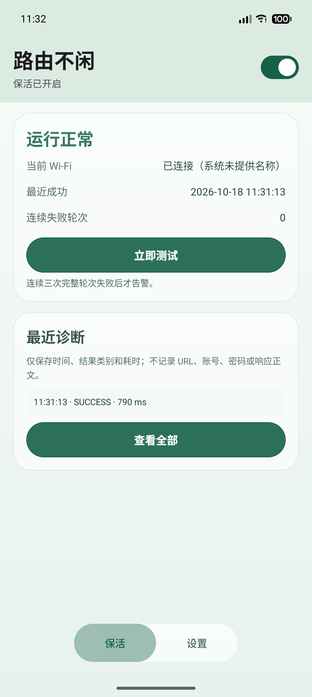
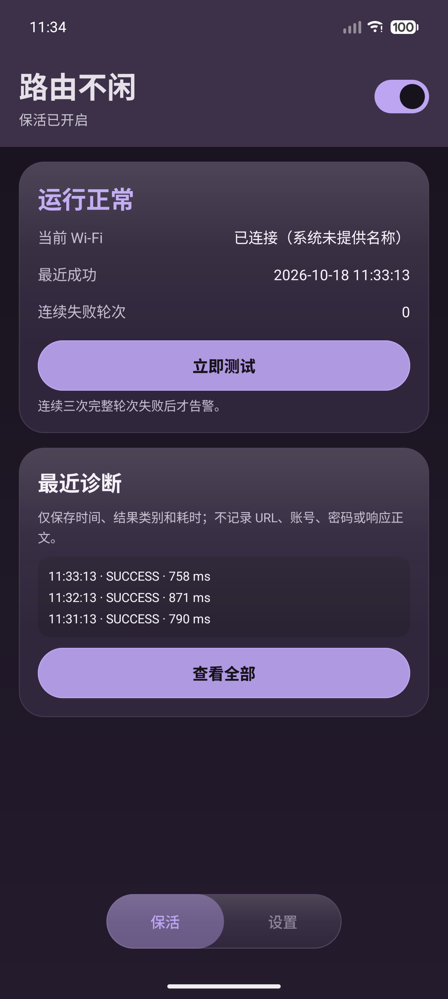
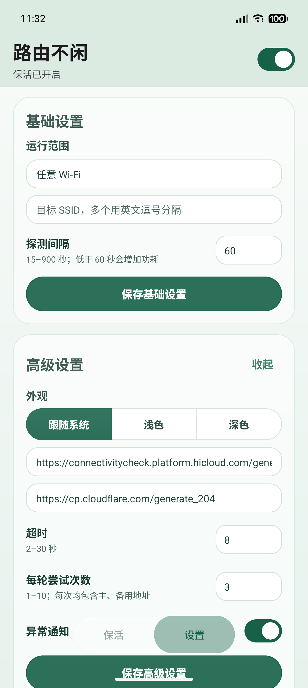
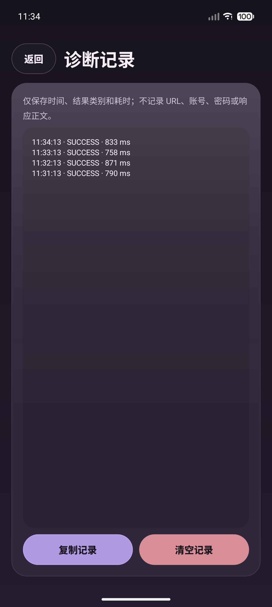

# 路由不闲

> **Keep your Wi-Fi link alive.** A tiny Android utility that issues low-frequency HTTPS probes so
> your router never sees an idle link and drops it — and raises an alert when three consecutive
> probe rounds fail.

一个把 Wi-Fi 连接"用活"的小工具：主动开启后以低频 HTTPS 请求制造外网活动，避免路由器因长时间无流量而断开或休眠；连续三轮完整探测失败时发出告警。

- applicationId：`com.fft.routerkeepalive`
- versionCode / versionName：`1000015` / `1.0.9`
- minSdk 24（Android 7.0）/ targetSdk 36
- 设备类型：phone、tablet（横竖屏、折叠屏自适应）
- 默认探测间隔 60 秒，可配置 15–900 秒
- 默认主地址：`https://connectivitycheck.platform.hicloud.com/generate_204`
- 默认备用地址：`https://cp.cloudflare.com/generate_204`
- 前台服务持续保活，已验证后台 / 锁屏 / Doze 三种场景

## 截图

| 浅色 | 深色 |
| --- | --- |
|  |  |

| 设置页 | 诊断记录 |
| --- | --- |
|  |  |

## 功能

- **两种运行范围**：任意 Wi-Fi / 仅指定 SSID / 仅手动测试
- **一键立即测试**：不必等待周期，随时验证当前网络是否可达
- **主备地址**：主地址失败自动尝试备用地址，两个都失败才计为一次失败
- **连续三轮失败才告警**：避免网络抖动造成误报
- **诊断记录**：最近 100 条，只存时间、结果类别、耗时
- **外观三选**：跟随系统 / 浅色 / 深色，即时生效
- **前台服务保活**：常驻通知显示当前状态，退到后台、锁屏、Doze 均持续工作

## 构建与安装

需要 **JDK 17** 与 **Android SDK（platform 36、build-tools 36.1.0）**。

```bash
# 1. 指向你的 SDK（也可直接用 Android Studio 打开工程，会自动生成）
echo "sdk.dir=/path/to/Android/Sdk" > local.properties

# 2. 单元测试
./gradlew testDebugUnitTest

# 3. 静态检查
./gradlew lintDebug

# 4. 可安装 APK（debug 用平台 debug 密钥签名，可直接安装）
./gradlew assembleDebug

# 5. release（见下方「签名」一节）
./gradlew assembleRelease
```

Windows 下把 `./gradlew` 换成 `gradlew.bat`。

产物：

- `app/build/outputs/apk/debug/app-debug.apk`
- `app/build/outputs/apk/release/app-release.apk`（配置了签名时）或 `app-release-unsigned.apk`

安装：

```bash
adb install -r app/build/outputs/apk/debug/app-debug.apk
adb shell am start -n com.fft.routerkeepalive/.MainActivity
```

> `local.properties` 不在版本控制中（含机器相关路径）。换机构建时删除它，由 Android Studio 或 `gradlew` 重新生成。

## 签名

release 构建默认输出**未签名** APK。要产出可分发/可上架的签名包：

1. 生成密钥库（一次性）：

```bash
keytool -genkeypair -v \
  -keystore release.jks -alias youralias \
  -keyalg RSA -keysize 2048 -validity 10950
```

2. 在仓库根目录创建 `keystore.properties`（该文件已被 `.gitignore` 排除）：

```properties
storeFile=/absolute/path/to/release.jks
storePassword=你的密码
keyAlias=youralias
keyPassword=你的密码
```

3. 重新执行 `./gradlew assembleRelease`，输出即为已签名 APK。

`app/build.gradle` 只有在 `keystore.properties` 存在时才配置签名，所以缺少该文件不会导致构建失败。

## 权限说明

| 权限 | 用途 |
| --- | --- |
| `INTERNET` / `ACCESS_NETWORK_STATE` | 发起探测、判断网络状态 |
| `ACCESS_WIFI_STATE` | 读取 Wi-Fi 可用性 |
| `NEARBY_WIFI_DEVICES`（Android 13+） | 读取 SSID，"仅目标 Wi-Fi" 范围需要；已声明 `neverForLocation` |
| `FOREGROUND_SERVICE` + `FOREGROUND_SERVICE_DATA_SYNC` | 前台服务保证后台持续保活 |
| `POST_NOTIFICATIONS`（Android 13+） | 常驻通知与失败告警 |

## 隐私

- 诊断最多保留 100 条，字段只有 `timestamp`、`category`、`durationMs`
- **不记录** URL、SSID、响应正文、账号、密码或设备标识
- 复制功能复制的也是同一份脱敏文本
- 全部数据只存在本机 SharedPreferences，不上传任何服务器

## 实现要点

- **前台服务而非 WorkManager**：周期探测需要精确到秒且不受 Doze 节流，`foregroundServiceType="dataSync"` 是唯一稳定方案
- **探测绑定 Wi-Fi 出口**：`Network.openConnection()` 把请求固定到当前 Wi-Fi 网络，不会因移动数据在场而走错出口
- **禁用自动重定向**：`instanceFollowRedirects = false`，强制门户的 302 会按 `REDIRECT` 类别计为失败，而不是被误判为成功
- **UI 采用液态玻璃**：半透明卡片 + 顶部高光 + 渐变描边，深浅色各自一套色板；按压有下沉与淡出反馈
- **不用 Compose**：纯 AndroidView + ViewBinding，包体更小（release 5.3 MB），低版本设备启动更快

## 已知限制

- **不支持开机自启**。Android 对普通应用的后台自启限制严格，注册 `BOOT_COMPLETED` 也常被厂商 ROM 拦截；为不做无法兑现的承诺，应用不注册该接收器，界面也不显示相关开关。
- **Android 10+ 对随机化 MAC 的 Wi-Fi 可能不返回真实 SSID**。此时「仅目标 Wi-Fi」无法匹配，界面会说明原因并建议改用「任意 Wi-Fi」。
- **Android 12+ 对前台服务启动来源有限制**。应用在后台时通过通知/Widget 之外的方式启动服务可能被拒；本应用的启动由用户在主界面显式操作触发，属于允许场景。若被系统拒绝，界面会显示「后台权限受限」并给出原因。
- **模拟器不暴露 SSID**。`ro.boot.qemu.virtiowifi=1` 的虚拟 Wi-Fi 会让 `WifiInfo` 返回 `networkId=-1` 与 `<unknown ssid>`，这是平台限制，真机上正常。

## 测试

31 个单元测试覆盖领域逻辑（运行范围判定、探测类别合并、失败计数、诊断格式化、设置校验、UI 策略插值等）：

```bash
./gradlew testDebugUnitTest
# 31 tests completed, 0 failed
```

实机验证（Pixel 10 Pro 模拟器 / 1280×2856 / 480dpi / API 36）：

| 场景 | 时长 | 结果 |
| --- | --- | --- |
| 前台 + 周期探测 | 60 min | 66 次探测全部执行，0 崩溃 |
| 后台 + 亮屏 | 8 min | 每分钟 +1 条诊断，服务存活 |
| 锁屏 | 5 min | 探测继续，pid 不变 |
| 后台 + 熄屏 + Doze IDLE | 8 min | 探测继续，常驻通知保留 |
| Doze 恢复 | 2 min | 立即继续，无丢周期 |
| force-stop 后重启 | — | 进程/服务/通知按预期停止，重启后设置全部保留 |

## 许可证

MIT，见 [LICENSE](LICENSE)。
